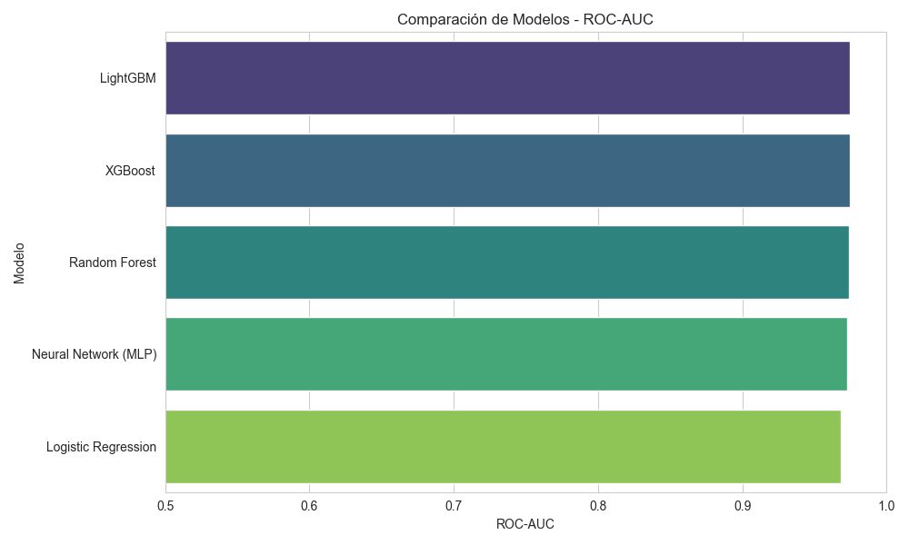
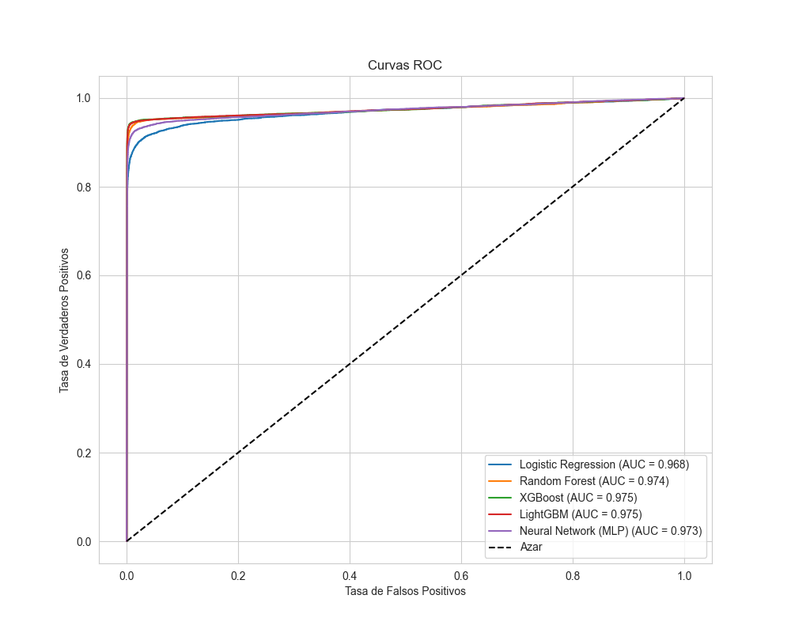
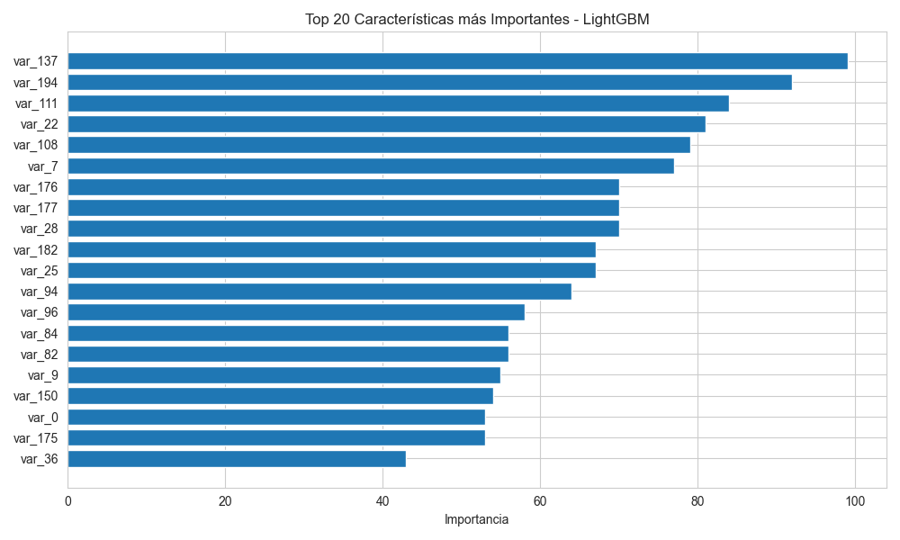
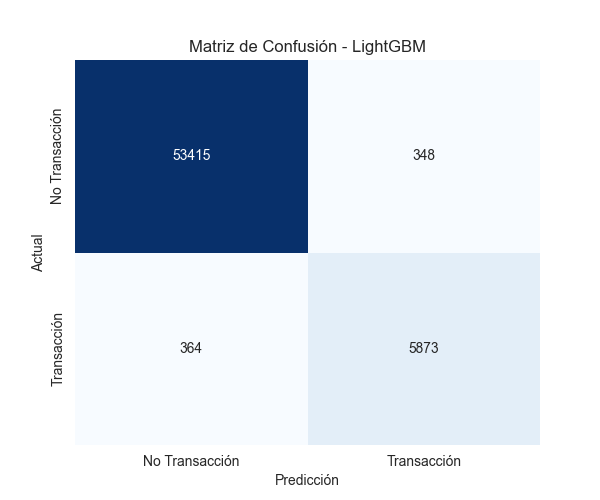

# Santander Customer Transaction Prediction


Predictive analytics pipeline inspired by the Kaggle competition *Santander Customer Transaction Prediction*: identify which bank customers will make a specific transaction, using 200 anonymous variables and a highly imbalanced target.

---

## Why this project

Banks constantly need to predict customer behavior: who will buy a product, default on a loan or churn. The Santander problem is a realistic version of that challenge, with anonymized features, noise and a minority class of about 10%. I built this project to practice the full modeling workflow on a problem shaped like real banking data and to compare classical, ensemble and neural models side by side.

## Objectives

1. Reproduce the structure of the original problem with a synthetic dataset of 200,000 customers and 200 features.
2. Explore distributions, outliers and correlations.
3. Train and compare five models on an imbalanced target.
4. Identify the best model and the most informative variables.

## Data

The dataset is **generated by the script** with `make_classification` to mirror the original competition: 200,000 rows, 20 informative variables, 40 redundant variables, 140 pure-noise variables, random shifts and scales, injected outliers and a 90/10 class split. The file `santander_synthetic_dataset.csv.gz` is created on the first run and is not stored in the repository because of its size.

## Methodology

1. **EDA:** target distribution, class-conditional histograms, boxplots for outliers, correlation matrix and correlation with the target.
2. **Preprocessing:** stratified 70/30 split and standardization.
3. **Imbalance handling:** SMOTE for Logistic Regression and the neural network; class weights and `scale_pos_weight` for tree ensembles.
4. **Models:** Logistic Regression, Random Forest, XGBoost, LightGBM and a multilayer perceptron (128-64-32, scikit-learn).
5. **Evaluation:** ROC-AUC ranking, ROC curves for all models, confusion matrix, classification report and top-20 feature importance for the best model.

## Visuals

| | |
|---|---|
|  |  |
|  |  |

## Repository structure

```
santander-transaction-prediction/
├── santander_quant_project.py    # data generation, EDA, modeling, evaluation
└── *.png                         # generated charts
```

## How to run

```bash
pip install numpy pandas matplotlib seaborn scikit-learn imbalanced-learn xgboost lightgbm
python santander_quant_project.py
```

## What this project means for my development

This project gave me hands-on experience with the models most used in industry for tabular banking data and with the practical side of imbalanced classification. It is the foundation for the credit-risk and fraud projects on my roadmap, where explainability and business cost will be added on top of predictive accuracy.

## Next steps

- Run the same pipeline on the original Kaggle data.
- Optimize the decision threshold with a business cost matrix instead of the default 0.5.
- Add SHAP explanations and probability calibration.

---

**Author:** Tomás Alarcón, Systems and Computing Engineering, Universidad de los Andes
